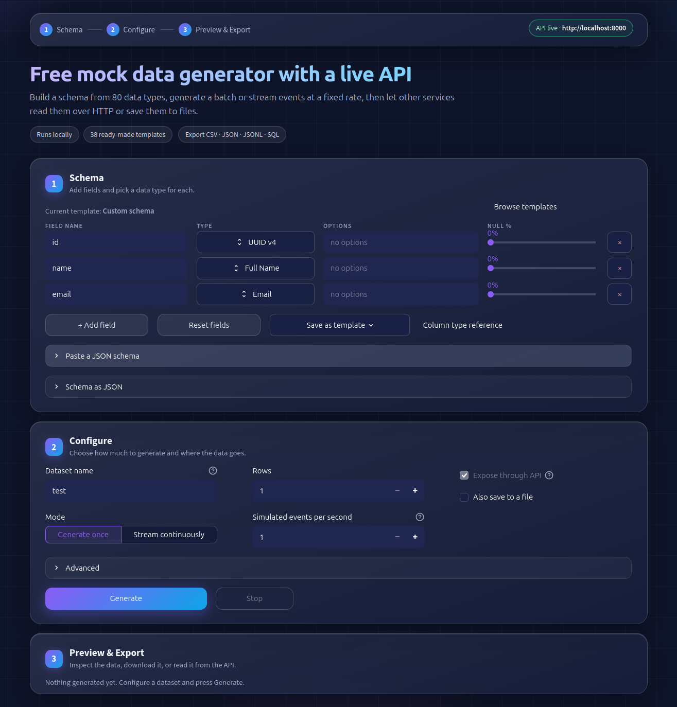
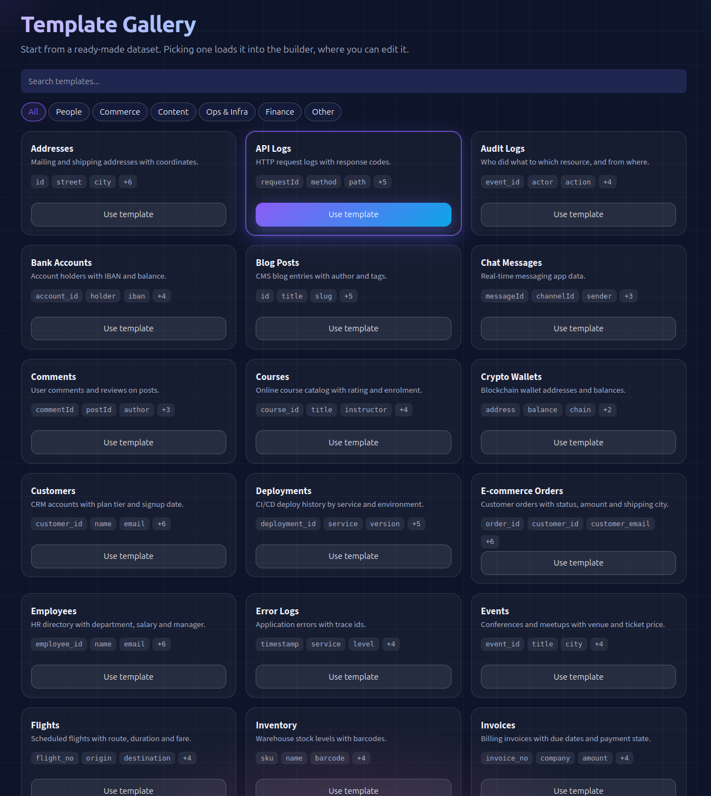
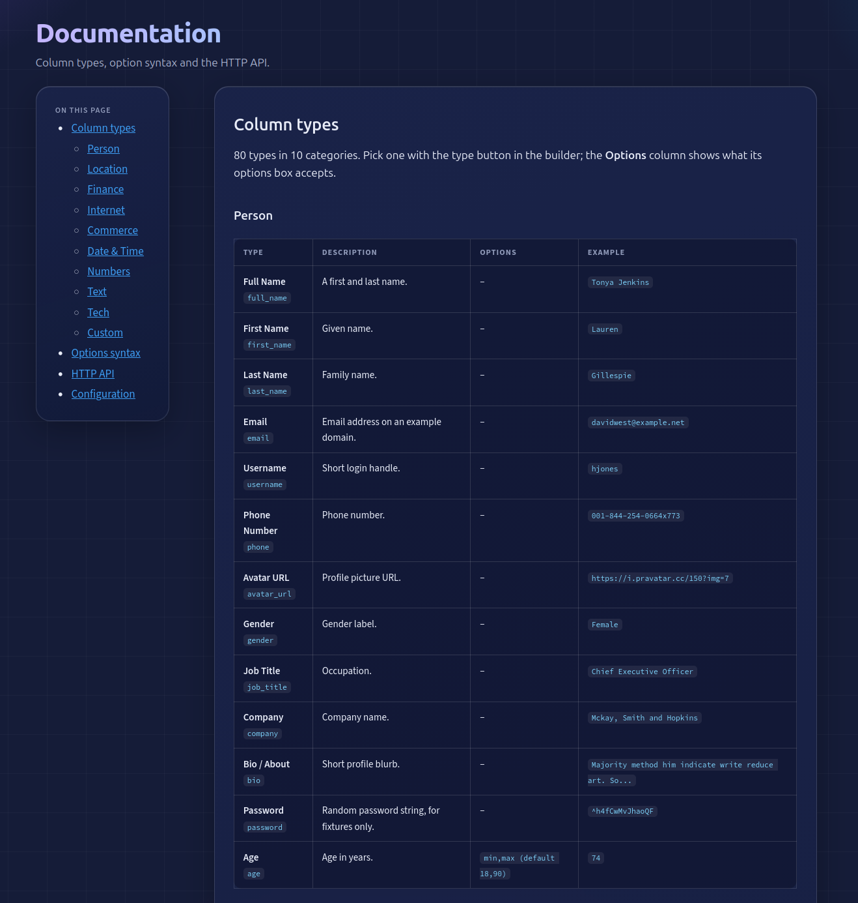

# Mock-Data-Gen
Generate mock data locally, then read it over an HTTP API or save it to files.

## Run

```bash
uv sync                       # Prerequisite (https://docs.astral.sh/uv/getting-started/installation/)
uv run mock-data-gen          # Streamlit UI (http://localhost:8501) + API (http://localhost:8000)
uv run mock-data-gen api      # API only
```

### Docker

```bash
docker compose up --build     # UI on :8501, API on :8000, saved files in ./output
```

Ports are published on `127.0.0.1` only; edit [docker-compose.yml](docker-compose.yml) to expose them on the network.
Without compose: `docker build -t mock-data-gen . && docker run -p 8501:8501 -p 8000:8000 -v "$PWD/output:/data" mock-data-gen`.

### Settings (environment variables)

Copy [.env.example](.env.example) to `.env`. Docker Compose reads it automatically; locally use `uv run --env-file .env mock-data-gen`.

| Variable                   | Default                           | Purpose                        |
| -------------------------- | --------------------------------- | ------------------------------ |
| `MOCK_DATA_API_HOST`       | `127.0.0.1` (`0.0.0.0` in Docker) | API bind address               |
| `MOCK_DATA_API_PORT`       | `8000`                            | API port                       |
| `MOCK_DATA_API_PUBLIC_URL` | `http://localhost:<port>`         | URL shown in the UI            |
| `MOCK_DATA_OUTPUT_DIR`     | `output` (`/data` in Docker)      | Default folder for saved files |

## Usage

1. Build columns on the home page (the type button opens a searchable picker grouped by category), paste a JSON schema, or open the Templates page (38 templates with search and category filters) to load a ready-made one into the builder. The Docs page lists every column type with its options and an example value.
2. Choose *Generate once* (N rows) or *Stream continuously* (events per second, optional row limit), and optionally save to CSV / JSON / JSONL / SQL.
3. Read the data from other services over HTTP; interactive docs are at `/docs`.

```bash
curl "http://localhost:8000/datasets/security_logs/rows?limit=10"
curl "http://localhost:8000/datasets/security_logs/rows?after=<cursor>"   # only newer rows
curl "http://localhost:8000/datasets/security_logs/rows?format=csv"
```

Column options: `integer` `1,100` | `float` `0,1,3` | `choice` `a:70|b:30` | `datetime` `-7d,now` | `sequence` `1,1`. See the Docs page for all types.

## Layout

```
docs/screenshots/   README images
src/mock_data_gen/
  cli.py            entry point (`mock-data-gen`)
  config.py         environment-based settings
  core/             column types, engine, in-memory dataset store, exporters
  generators/       built-in generators (security logs)
  templates/        template catalog
  api/              FastAPI routes and background server launcher
  ui/               Streamlit app: views/ (builder, templates, docs), sections/, state, theme
```

## Pages

### Builder

Define fields, configure generation and preview, export or serve the data.



### Templates

38 ready-made datasets with search and category filters.



### Docs

Every column type with its options and an example value, plus options syntax and the HTTP API.



## License

Released under the [GNU General Public License v3.0](LICENSE).
